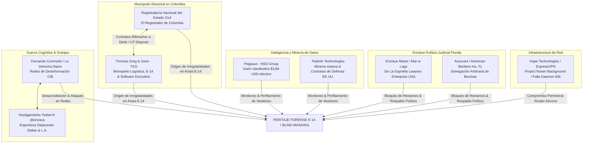

# 🔬 DOSSIER PERICIAL: LA RED TRANSNACIONAL, CIBERVIGILANCIA Y MONOPOLIO ELECTORAL
**Acervo y Auditoría Técnica:** AndreTaker / BaBaYaga Core  
**Estándar de Preservación Digital:** ISO/IEC 27037:2012  
**Fecha:** Octubre de 2026  
**Ámbito:** Investigación Forense de Poder Corporativo, Ciberdefensa y Tecnologías Electorales  

---

## 🧭 1. ESTRUCTURA DE LA RED Y MAPA DE CONVERGENCIA

---

## 🏛️ 2. EL MONOPOLIO ELECTORAL: LA REGISTRADURÍA Y THOMAS GREG & SONS (TGS)

### A. El Núcleo del Sistema: Thomas Greg & Sons
* **El Contratista Permanente:** Thomas Greg & Sons (TGS), a través de uniones temporales sucesivas (como *Unión Temporal Disproel*), ha mantenido el control monopólico durante más de una década de todos los componentes críticos del sistema electoral colombiano:
  1. **Impresión y Distribución de Actas Físicas:** Producción de los formularios de mesa **E-14** (Claveros, Delegados y Transmisión).
  2. **Escaneo, Digitalización y Transmisión:** Operación de los centros de digitalización y transmisión de las imágenes E-14 hacia los servidores centrales de preconteo.
  3. **Software de Escrutinio:** Suministro y parametrización de las plataformas de consolidación de votos, operadas como software privativo sin auditoría ciudadana independiente del código fuente.
* **La Crisis Institucional y Puertas Giratorias:**
  * La empresa ha estado en el centro de disputas de alto nivel en Colombia (incluyendo la crisis de los pasaportes en la Cancillería y demandas millonarias contra el Estado).
  * Exfuncionarios de alto rango del Estado, diplomáticos y expresidentes han figurado históricamente en sus juntas directivas o vínculos corporativos, garantizando una posición de blindaje institucional ante cualquier cuestionamiento a sus contratos.

### B. El Rol de la Registraduría Nacional del Estado Civil
* **La Jefatura del Sistema (El Registrador):**
  * La Registraduría delega en TGS la arquitectura técnica completa del proceso electoral, evadiendo la implementación de un software público, auditable y de código abierto de propiedad exclusiva del Estado.
  * **La Evidencia de Alteración:** El peritaje forense sobre las actas E-14 demostró la existencia de cicatrices estructurales en las imágenes digitalizadas por los sistemas contratados:
    * *Inyección de XObjects:* Manipulación interna del árbol de objetos de los PDFs.
    * *Blind Masking:* Enmascaramiento de celdas mediante campos artificialmente esterilizados (`Std=0`).
    * *Deltas XREF Fantasma (+2):* Modificaciones posteriores a la firma de mesa registradas en los catálogos del documento.

---

## 🛰️ 3. EL COMPLEJO DE CIBERVIGILANCIA: PEGASUS Y PALANTIR

### A. Pegasus (NSO Group) en Colombia
* **Operación Financiera Clandestina:** Compra confirmada de software espía Pegasus durante el gobierno de Iván Duque mediante el transporte aéreo de **11 millones de dólares en efectivo** sin registro presupuestal público hacia Israel.
* **Uso contra la Veeduría:** Despliegue de capacidades militares de interceptación telefónica y ambiental orientado a monitorear a investigadores independientes y figuras de oposición.

### B. Palantir Technologies y la Minería de Datos
* **Contratos Gubernamentales:** Palantir opera como proveedor clave de analítica de datos, grafos de conexión (*Entity Resolution*) y minería para agencias de seguridad y defensa de EE. UU.
* **Mitigación Técnica Registrada:** El acervo pericial de BaBaYaga Core implementó el **Protocolo Anti-Palantir** (`invocar_andretaker.py -ap`), anulando la capacidad de indexación automática de estos motores mediante mutación controlada de firmas SHA-256 en copias y purga de metadatos Exif/XMP.

---

## 🤖 4. GUERRA COGNITIVA Y DESINFORMACIÓN: CASO CERIMEDO Y ARCHIVO TWITTER/X

### A. Trazabilidad del Archivo Digital (@anzaca)
* **Archivo Maestro:** `twitter-2026-09-06-9eb32ebc9ab3f304dda1ae8d61c292b565a78a29832755256030833f3f559b39.zip` (4.5 GB).
* **Firma Criptográfica SHA-256:** `18045e289795fe5d6a863057513f359c6e2fda8245a17186aa5a13c7d1c36a18`.
* **Requerimiento Legal:** Notificación **18 U.S.C. § 2703(f)** radicada ante X Corp. para preservación de logs y cadenas User-Agent.

### B. La Red Fernando Cerimedo / Granjas de Bots
* **Identidad Operativa:** El análisis de tráfico sobre `@anzaca` registró ataques provenientes de datacenters en Dallas (`AS39944`) y Los Ángeles (`AS62240`), coincidentes con el modus operandi de la red desmantelada judicialmente en Brasil y Bolivia encabezada por Fernando Cerimedo (*La Derecha Diario*), basada en conmutadores *SIM-box* y enjambres de cuentas inauténticas coordinadas (CIB).

---

## 🏛️ 5. EL ENCLAVE DE PODER EN MIAMI: DE LA ESPRIELLA Y ASSURANT

### A. La Plataforma de Cabildeo en Florida
* **De La Espriella Lawyers Enterprise USA:** Establecimiento de operaciones en el sur de Florida con nexos públicos a círculos de Mar-a-Lago y figuras de la corriente MAGA, sirviendo de puente de defensa jurídica y articulación política para intereses de la derecha tradicional colombiana.

### B. Assurant (American Bankers Insurance Co. of Florida)
* **Sede Central:** Miami, Florida.
* **Denegación de Cobertura:** Denegó dos veces de manera arbitraria el reclamo `Claim #00115536906` (Póliza `#IFS002070403`) derivado de una alerta oficial de más de **40 brechas de identidad en la Dark Web** emitida por ExpressVPN.
* **Proceso Regulatorio:** Expediente activo por mala fe aseguradora ante la **Virginia State Corporation Commission (SCC Complaint #153658)**.

---

## 🌐 6. INFRAESTRUCTURA INTERMEDIARIA: KAPE TECHNOLOGIES & EXPRESSVPN

* **Antecedentes:** Empresa matriz de ExpressVPN dirigida por Teddy Sagi, con directivos confesos de espionaje encubierto ante el DOJ (Project Raven).
* **Telemetría Cruda Preservada:**
  * **Ticket #32148290:** Compromiso y emisión de balizas en router Aircove (`expressvpn-router-logs-2026-06-23-08_26_33.txt`, 332 KB).
  * **62.616 Errores Cíclicos en Linux:** Fallas `DaemonConnectionError 500` con bloqueo de memoria compartida (`QSharedMemory::create: already exists`) que incomunicaron la estación de trabajo en septiembre de 2026.
  * **Ticket #32728459:** Requerimiento formal activo de ExpressVPN solicitando las pruebas de denegación de Assurant y la alerta de Dark Web para el expediente regulatorio.

---

## 📊 7. REGISTRO OFICIAL DE RADICADOS Y EXPEDIENTES

| Ámbito | Institución / Organismo | Número de Radicado / ID | Objeto |
| :--- | :--- | :--- | :--- |
| **Electoral / Medios** | RTVC Sistema de Medios Públicos | **Radicado 202605510107022** | Denuncia formal de fraude en actas E-14 y Blind Masking |
| **Judicial Penal** | Rama Judicial de Colombia | **Denuncia Penal ante Juez** | Investigación penal sobre alteración de documentos públicos |
| **Internacional DDHH** | CIDH (Comisión Interamericana) | **CIDH - 0000117118 (MC-1137-28)** | Petición formal de Medidas Cautelares |
| **Regulatorio EE. UU.** | Virginia Bureau of Insurance (SCC) | **Complaint ID #153658** | Investigación por Mala Fe contra Assurant |
| **Telecomunicaciones** | X Corp. (Twitter Legal) | **18 U.S.C. § 2703(f)** | Preservación de logs y User-Agents de clústeres invasores |
| **Soporte / Forense** | ExpressVPN / Zendesk | **Tickets #32148290 y #32728459** | Telemetría de router Aircove y Alerta Dark Web 26/06/2026 |
